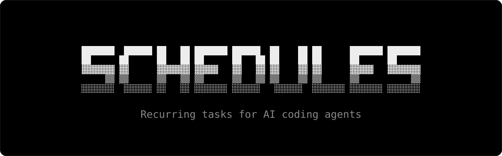

<p align="center">
  <a href="https://schedules.sh">
    
  </a>
</p>

<p align="center">
  <a href="https://www.npmjs.com/package/agent-schedules"></a>
  <a href="LICENSE"></a>
</p>

Schedules are recurring prompts for your coding agent, kept as Markdown files in your repository. Discover them at [schedules.sh](https://schedules.sh).

## Add a schedule

```sh
npx agent-schedules add <owner/repo>
```

Then `npx agent-schedules push <harness>` registers it with your agent: T3 Code, the Codex or Claude desktop app, or the Codex, Claude Code, Pi, OpenCode or Cursor CLI.

See the [docs](https://schedules.sh/docs) for every command and option.
